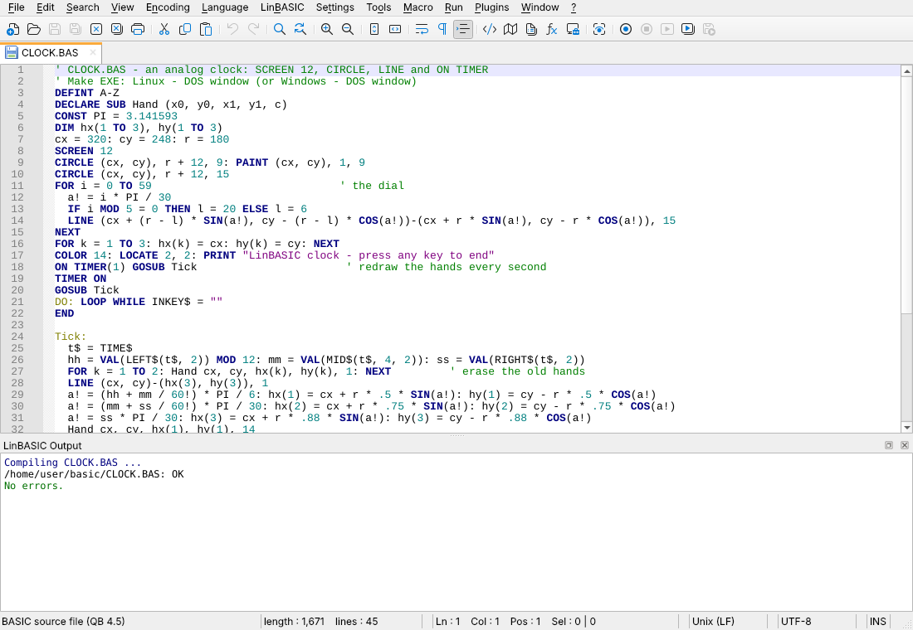
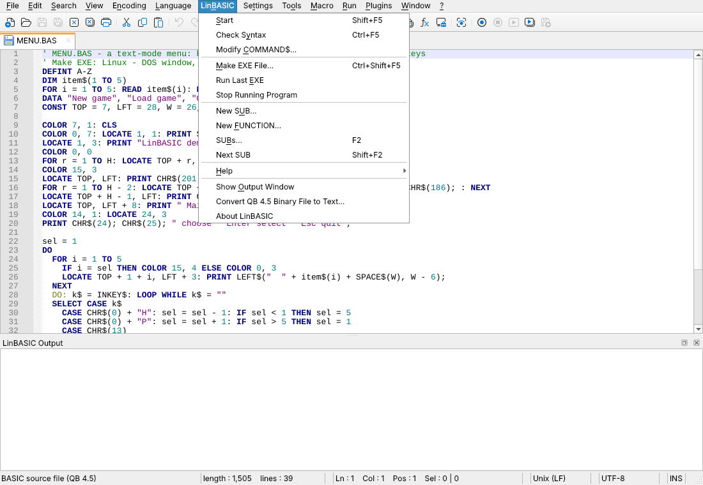
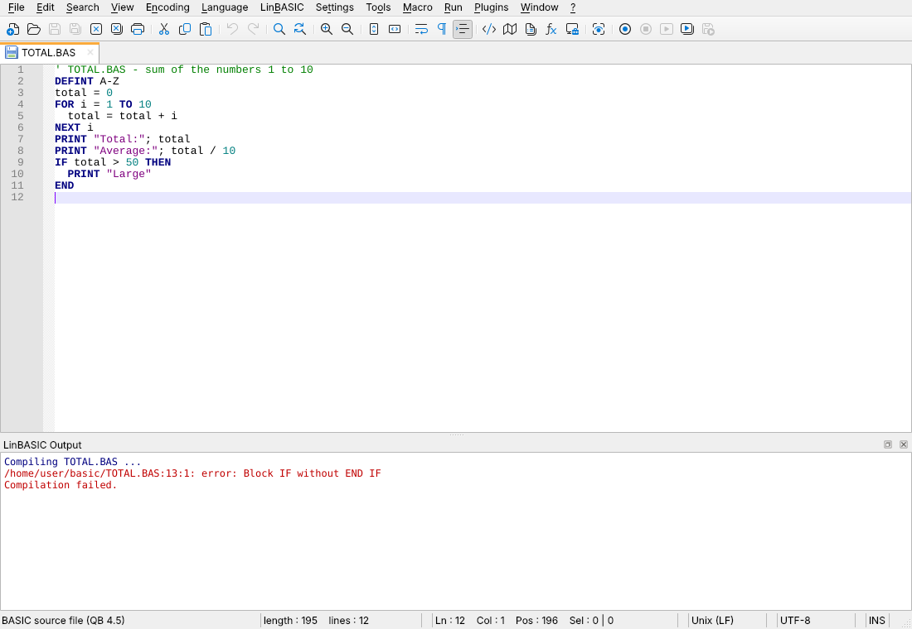
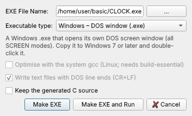
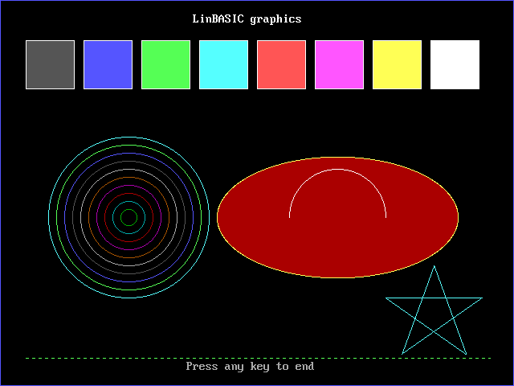
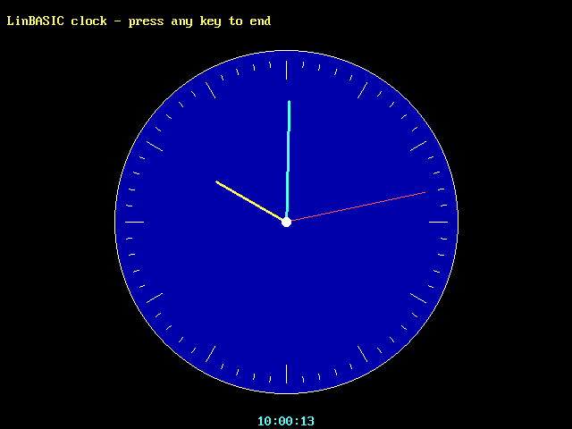
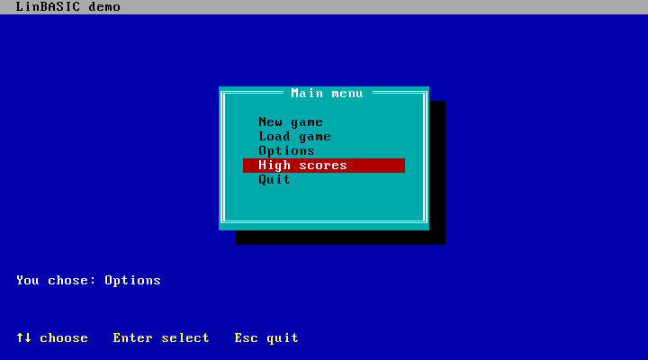
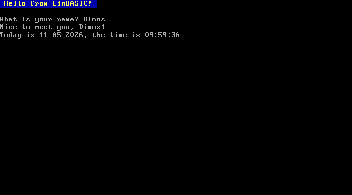
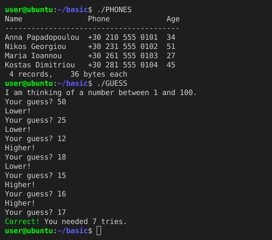

# LinBASIC

**A QB 4.5 compatible BASIC compiler and IDE for Linux and Windows.**

LinBASIC compiles classic DOS BASIC programs (the QB 4.5 dialect) into native x86-64
executables for Linux or Windows, and comes with an IDE built on
[Linpad++](https://github.com/demosthenesk/Linpad-plus-plus) (a Notepad++ clone for Linux).
Its behaviour was reverse engineered (REA) from Microsoft's QB 4.5 and checked against
the original compiler, so old programs run the way they did in DOS: same screen, same
numbers, same graphics, same files.



* **`lbc` compiler:** BASIC → C → machine code through the bundled Tiny C Compiler, so
  nothing else has to be installed.
* **The DOS screen:** compiled programs open their own window with the VGA font and palette.
  Text mode, colours, `LOCATE`, `INKEY$` with extended keys, and every graphics mode
  (`SCREEN` 1–13) look and behave as in DOS. Programs can also run in a terminal, or with
  their output redirected.
* **Windows programs:** the same source becomes a Windows `.exe`, either with its own DOS
  window or as a `cmd.exe` console program.
* **Runs on Windows too:** portable 32-bit and 64-bit editions of the IDE and compiler for
  Windows 7 or later (see [Windows](#windows)).
* **IDE:** Linpad++ with a **LinBASIC** menu:
  * Start (F5), Make EXE, Check Syntax and Modify COMMAND$
  * an error list that jumps to the line and marks it
  * SUBs (F2), New SUB and New FUNCTION
  * syntax highlighting, auto-completion and a function list
  * F1 help from your own QB 4.5 help files (see [Help](#help))

## Contents

* [Screenshots](#screenshots)
* [Download](#download)
* [Quick start](#quick-start)
* [Windows](#windows)
* [Examples](#examples)
* [Help](#help)
* [The compiler](#the-compiler)
* [Running compiled programs](#running-compiled-programs)
* [Building from source](#building-from-source)
* [How it was reverse engineered (REA)](#how-it-was-reverse-engineered-rea)
* [License](#license)

## Screenshots

### The IDE

The **LinBASIC** menu holds everything for BASIC work: run, check, make an executable,
manage SUBs and FUNCTIONs, and open the help.



**Check Syntax** (Ctrl+F5) and **Start** (F5) list errors in the *LinBASIC Output* pane in the
`file:line:col: error: message` format. Clicking an error jumps to the line.



**Make EXE File** (Ctrl+Shift+F5) asks for the executable type: a Linux program with its own
DOS window or for the terminal, or a Windows `.exe` with a DOS window or for the cmd console.



### Programs made with LinBASIC

Each program below is one of the [examples](#examples), compiled with `lbc` and shown in
its DOS screen window.

| | |
|:---:|:---:|
|  |  |
| **SHAPES.BAS** — SCREEN 12: `LINE`, `CIRCLE`, `PAINT`, `DRAW` | **CLOCK.BAS** — an analog clock driven by `ON TIMER` |
|  |  |
| **FRACTAL.BAS** — the Mandelbrot set in SCREEN 13 with a custom `PALETTE` | **MENU.BAS** — text mode: box characters, colours, arrow keys |
|  |  |
| **STARS.BAS** — a SCREEN 13 starfield synchronised with `WAIT &H3DA, 8` | **HELLO.BAS** — `COLOR`, `INPUT`, `DATE$` and `TIME$` |

### Terminal programs

Built with the *Linux – terminal* type (`lbc --console`), a program behaves like any
command-line tool in bash: plain lines, terminal colours, and `INPUT` with the terminal's
own line editing.



## Download

Every [release](https://github.com/demosthenesk/LinBASIC/releases) has these files:

| File | Contents |
|---|---|
| `LinBASIC-<version>-x86_64.AppImage` | Linux: IDE + compiler (the compiler also runs as `./LinBASIC-…AppImage lbc prog.bas`) |
| `lbc-<version>-x86_64.AppImage` | Linux: the command-line compiler only |
| `LinBASIC-<version>-win32.zip` | Windows 7 or later, 32- or 64-bit: portable IDE + compiler, makes 32-bit programs |
| `LinBASIC-<version>-win64.zip` | Windows 7 or later, 64-bit: portable IDE + compiler, makes 64-bit programs |

The AppImages run on Ubuntu 24.04 and other current x86-64 Linux distributions.

```sh
chmod +x LinBASIC-1.0.4-x86_64.AppImage lbc-1.0.4-x86_64.AppImage
```

## Quick start

**In the IDE**

1. Start `./LinBASIC-1.0.4-x86_64.AppImage` and open a `.BAS` file, for example
   `examples/SHAPES.BAS`.
2. Press **F5** (*LinBASIC → Start*). The program is compiled and opens in its DOS window.
3. To keep the program, choose **LinBASIC → Make EXE File…**, pick the executable type and
   press **Make EXE**.

**On the command line**

```sh
./lbc-1.0.4-x86_64.AppImage -o shapes examples/SHAPES.BAS            # Linux, DOS window
./shapes
./lbc-1.0.4-x86_64.AppImage --console -o guess examples/GUESS.BAS    # Linux, terminal
./guess
./lbc-1.0.4-x86_64.AppImage --windows -o CLOCK.EXE examples/CLOCK.BAS             # Windows, DOS window
./lbc-1.0.4-x86_64.AppImage --windows --console -o PHONES.EXE examples/PHONES.BAS # Windows, cmd console
```

## Windows

The Windows editions are portable: extract the zip file anywhere you can write to (your
Documents folder, a USB stick; not *Program Files*) and start `LinBASIC.exe`. Nothing is
installed, and the settings stay in the `settings` folder next to it.

```
LinBASIC-1.0.4-win64\
  LinBASIC.exe      the IDE
  lbc.exe           the compiler:  lbc -o HELLO.EXE examples\HELLO.BAS
                                   lbc --console -o GUESS.EXE examples\GUESS.BAS
  examples\         the example programs
  settings\         the IDE settings (portable mode)
```

* The IDE works as on Linux: **F5** compiles and runs the program, and **Make EXE File…** makes
  a *Windows – DOS window* or *Windows – cmd console* program. The 32-bit edition makes 32-bit
  programs, which run on every Windows from 7 on; the 64-bit edition makes 64-bit programs.
* Windows 7 needs SP1 with the updates KB2533623 (or KB3063858) and KB2999226 (Universal C
  Runtime), which Windows Update installs. Windows 8.1, 10 and 11 already have them.
* Qt 6 needs Windows 10, so the Windows IDE runs on Qt 5.15 and Python 3.8, the last versions
  for Windows 7 (`packaging/win/pyqt6shim` lets the PyQt6 code of the IDE run on PyQt5).
  Programs are compiled with a Windows build of the bundled Tiny C Compiler.
* The help works the same way: **LinBASIC → Help → Set Help Folder…** and your own QB 4.5
  help files.

## Examples

The [`examples/`](examples) folder contains small programs that show the main parts of the
language. The first lines of each file say which executable type suits it.

| File | What it shows | Best Make EXE type |
|---|---|---|
| [`HELLO.BAS`](examples/HELLO.BAS) | `CLS`, `COLOR`, `INPUT`, `DATE$`, `TIME$` | any |
| [`GUESS.BAS`](examples/GUESS.BAS) | `RANDOMIZE TIMER`, `RND`, `INPUT`, `DO … LOOP UNTIL` | Linux – terminal / Windows – cmd console |
| [`PHONES.BAS`](examples/PHONES.BAS) | `TYPE` records in a `RANDOM` file, `GET`/`PUT`, `LOF`, `PRINT USING` | Linux – terminal / Windows – cmd console |
| [`MENU.BAS`](examples/MENU.BAS) | text mode: CP437 box characters, `LOCATE`, `INKEY$` with arrow keys, `SELECT CASE` | any |
| [`SHAPES.BAS`](examples/SHAPES.BAS) | SCREEN 12: `LINE` (`B`, `BF`, styles), `CIRCLE`, `PAINT`, `DRAW` | Linux / Windows – DOS window |
| [`CLOCK.BAS`](examples/CLOCK.BAS) | SCREEN 12, `ON TIMER(1) GOSUB`, a `SUB` with parameters, `SIN`/`COS` | Linux / Windows – DOS window |
| [`FRACTAL.BAS`](examples/FRACTAL.BAS) | SCREEN 13, 256 colours, `PALETTE`, `PSET`, floating-point loops | Linux / Windows – DOS window |
| [`STARS.BAS`](examples/STARS.BAS) | SCREEN 13 animation, arrays of `SINGLE`, `WAIT &H3DA, 8` (vertical retrace) | Linux / Windows – DOS window |
| [`MUSIC.BAS`](examples/MUSIC.BAS) | `PLAY` (music macro language), `SOUND`, `BEEP` | any |

### Hello, LinBASIC

```basic
' HELLO.BAS - first LinBASIC program
CLS
COLOR 14, 1
PRINT " Hello from LinBASIC! "
COLOR 7, 0
PRINT
INPUT "What is your name"; n$
PRINT "Nice to meet you, "; n$; "!"
PRINT "Today is "; DATE$; ", the time is "; TIME$
```

### A game for the terminal

```basic
' GUESS.BAS - a number guessing game for the terminal
RANDOMIZE TIMER
secret = INT(RND * 100) + 1
PRINT "I am thinking of a number between 1 and 100."
DO
  INPUT "Your guess"; g
  tries = tries + 1
  IF g < secret THEN PRINT "Higher!"
  IF g > secret THEN PRINT "Lower!"
LOOP UNTIL g = secret
COLOR 10: PRINT "Correct!"; : COLOR 7
PRINT " You needed"; tries; "tries."
```

### Records in a RANDOM file

`PHONES.BAS` defines a `TYPE`, writes four records with `PUT` the first time it runs, and
lists the file with `PRINT USING`. The file `PHONES.DAT` has exactly the layout QB 4.5
writes (36 bytes per record).

```basic
TYPE Person
  nam AS STRING * 18
  phone AS STRING * 16
  age AS INTEGER
END TYPE
DIM p AS Person
OPEN "PHONES.DAT" FOR RANDOM AS #1 LEN = LEN(p)
' ... the first run fills the file from DATA lines with PUT #1, i, p ...
FOR i = 1 TO LOF(1) \ LEN(p)
  GET #1, i, p
  PRINT USING "\                \ \              \ ###"; p.nam; p.phone; p.age
NEXT
CLOSE #1
```

### Graphics

```basic
' SHAPES.BAS - SCREEN 12 graphics: LINE, CIRCLE, PAINT and DRAW
SCREEN 12
LINE (0, 0)-(639, 479), 9, B
COLOR 15: LOCATE 2, 31: PRINT "LinBASIC graphics"
FOR i = 0 TO 7                              ' a row of coloured boxes
  LINE (32 + i * 72, 50)-(92 + i * 72, 110), i + 8, BF
  LINE (32 + i * 72, 50)-(92 + i * 72, 110), 15, B
NEXT
FOR r = 10 TO 100 STEP 10                   ' rings
  CIRCLE (160, 270), r, r \ 10 + 1
NEXT
CIRCLE (420, 270), 150, 14, , , .5          ' an ellipse, filled with PAINT
PAINT (420, 270), 4, 14
CIRCLE (420, 270), 60, 15, 0, 3.14159       ' a half circle
DRAW "C11 BM540,330 M+40,110 M-100,-70 M+120,0 M-100,70 M+40,-110"   ' a star
LINE (30, 445)-(610, 445), 10, , &HF0F0     ' a dashed line
COLOR 7: LOCATE 29, 30: PRINT "Press any key to end";
DO: LOOP WHILE INKEY$ = ""
```

### Events: ON TIMER

`CLOCK.BAS` redraws its hands once a second from an event handler, while the main program
only waits for a key:

```basic
ON TIMER(1) GOSUB Tick                       ' redraw the hands every second
TIMER ON
GOSUB Tick
DO: LOOP WHILE INKEY$ = ""
END

Tick:
  t$ = TIME$
  hh = VAL(LEFT$(t$, 2)) MOD 12: mm = VAL(MID$(t$, 4, 2)): ss = VAL(RIGHT$(t$, 2))
  ' ... erase the old hands, compute the new ones with SIN/COS, draw them ...
  COLOR 11: LOCATE 30, 37: PRINT t$;
RETURN
```

### 256 colours

```basic
' FRACTAL.BAS - the Mandelbrot set in SCREEN 13 (320x200, 256 colours)
DEFINT A-Z
CONST MAXIT = 63
SCREEN 13
FOR i = 1 TO 63                             ' a palette from dark blue to white
  b = i * 3: IF b > 63 THEN b = 63
  g = (i * i) \ 63: r = (i * i \ 63) * i \ 63
  PALETTE i, 65536& * b + 256& * g + r
NEXT
FOR py = 0 TO 199
  y0! = -1.2 + py * 2.4 / 200
  FOR px = 0 TO 319
    x0! = -2.25 + px * 3.2 / 320
    x! = 0: y! = 0: it = 0
    DO WHILE x! * x! + y! * y! < 4 AND it < MAXIT
      xt! = x! * x! - y! * y! + x0!
      y! = 2 * x! * y! + y0!
      x! = xt!
      it = it + 1
    LOOP
    IF it = MAXIT THEN PSET (px, py), 0 ELSE PSET (px, py), it
  NEXT
NEXT
DO: LOOP WHILE INKEY$ = ""
```

Your own QB 4.5 programs from the DOS days should compile the same way, including files saved
in QB's binary ("fast load") format.

## Help

LinBASIC does **not** include any help files: the QB 4.5 help databases are Microsoft's work
and are not redistributed. If you own a copy of QB 4.5, LinBASIC can show its complete
reference (about 990 topics) in the IDE:

1. Find the folder of your QB 4.5 installation that contains `QB45ADVR.HLP`,
   `QB45QCK.HLP` and `QB45ENER.HLP`.
2. In the IDE choose **LinBASIC → Help → Set Help Folder…** (or the **Help Files…** button in
   the help pane) and select that folder.

LinBASIC remembers the folder. F1 on a keyword then opens its help topic, and
**Help → Contents / Index** browse the whole reference, with working hyperlinks.
The files are only read and are never changed.
Without help files, F1 shows a short built-in summary of the keyword.

## The compiler

```
lbc [options] FILE.BAS
  -o FILE        output executable (default: FILE without .BAS, FILE.exe for Windows)
  --target linux|windows   (or --windows) make a Linux program or a Windows .exe
  -c             only generate C source           -C   keep the C source
  -O             optimise with the system gcc instead of the bundled tcc (Linux)
  --console      terminal (Linux) / cmd console (Windows) program instead of a DOS window
  --crlf         write text files with CR+LF line ends (DOS style; always on for Windows)
  --run          run the program after compiling   --check  syntax check only
  -I DIR         $INCLUDE search path
  --convert IN OUT   convert a QB 4.5 binary ("fast load") .BAS to text
```

Errors use the `file:line:col: error: message` format.
Both text `.BAS` files and QB 4.5 **binary (fast load) files** are accepted, and a UTF-8
source is converted to code page 437. `'$INCLUDE: 'QB.BI'` works: a compatible `QB.BI`
is built in for `CALL INTERRUPT`.

### Executable types

| Make EXE choice | `lbc` options | Result |
|---|---|---|
| Linux – DOS window | *(default)* | Linux program with its own DOS screen window |
| Linux – terminal | `--console` | Linux program for the terminal |
| Windows – DOS window (.exe) | `--windows` | Windows GUI program with its own DOS screen window |
| Windows – cmd console (.exe) | `--windows --console` | Windows console program for cmd.exe |

A terminal or console program behaves like any command-line program: it writes plain lines,
which can also be redirected or piped, and `INPUT` uses the terminal's own line editing.
`INKEY$`, `SLEEP`, `COLOR` and `CLS` work in that line flow, with the default colours being the
terminal's own. Ctrl+C ends the program and leaves the terminal as it was.
`LOCATE`, `VIEW PRINT` or `PCOPY` switch it to a full 80×25 text screen, and a graphics `SCREEN`
mode continues in a window.

**Windows programs** are made with the bundled `x86_64-win32-tcc` cross compiler and a
Windows build of the runtime. They need only 64-bit Windows 7 or later and its standard
`msvcrt.dll`:

* the cmd console target writes straight to the console buffer (colours, CP437 box
  characters, blinking, extended keys, Ctrl+Break)
* the window target uses GDI, and sound uses `waveOut`
* `SHELL` runs `cmd.exe`, file names are used as written (`C:\DATA\FILE.TXT`), and text
  files get CR+LF line ends

The Windows build passes the same `tests/` suite as the Linux build (checked with Wine 9).

### Language coverage

The whole QB 4.5 core language is supported:

* **Types:** INTEGER, LONG, SINGLE, DOUBLE, STRING, `STRING * n`, user `TYPE`s (nested), arrays of all of them (multi-dimensional, `TO` ranges, `$DYNAMIC`, `REDIM`, `ERASE`, `OPTION BASE`), `CONST`, `DEFINT`…`DEFSTR`.
* **Control flow:**
  * `IF` (single-line and block), `SELECT CASE` (`IS`, `TO`, lists), `FOR`/`NEXT i, j`, `DO`/`LOOP` (`WHILE`/`UNTIL`), `WHILE`/`WEND`, `EXIT`
  * `GOTO`/`GOSUB`/`RETURN`, `ON … GOTO/GOSUB`, line numbers and labels
* **Procedures:** `SUB`/`FUNCTION` with by-reference parameters, recursion, `STATIC`, `SHARED`, `DECLARE`, `DEF FN` (single-line and block), `COMMON SHARED`, `CHAIN`.
* **Errors and events:** `ON ERROR GOTO` with `RESUME` / `RESUME NEXT` / `RESUME label` (resumes inside SUBs just like QB), `ERR`, `ERL`, `ERROR n`, plus `ON KEY(n)`, `ON TIMER(n)` and `ON PLAY(n)` with `KEY(n)/TIMER ON|OFF|STOP`.
* **I/O:**
  * `PRINT`, `PRINT USING`, `WRITE`, `INPUT`, `LINE INPUT`, `INKEY$`, `INPUT$`, `LOCATE`, `COLOR`, `CLS`, `WIDTH`, `VIEW PRINT`, `SCREEN()`, `CSRLIN`, `POS`
  * files: `OPEN` (both syntaxes) for INPUT/OUTPUT/APPEND/RANDOM/BINARY, `FIELD`/`LSET`/`RSET`, `GET`/`PUT`, `SEEK`, `EOF`/`LOF`/`LOC`, `KILL`, `NAME`, `MKDIR`/`CHDIR`/`RMDIR`, `FILES`, `FREEFILE`
  * DOS file names (`C:\DIR\FILE.TXT`) are mapped on Linux, and names are matched case-insensitively.
* **Graphics:**
  * `SCREEN` 0, 1, 2, 3, 4, 7, 8, 9, 10, 11, 12 and 13 with pages, `PCOPY`, `PALETTE`, `PALETTE USING`
  * `PSET`/`PRESET`, `LINE` (B, BF, styles), `CIRCLE` (arcs, aspect), `PAINT` (tiles), `DRAW` (incl. `VARPTR$`), `VIEW`, `WINDOW`, `PMAP`, `POINT`, `GET`/`PUT` (QB array format: PSET, PRESET, AND, OR, XOR)
* **Sound:** `BEEP`, `SOUND`, `PLAY` (full MML, MF/MB) through PulseAudio (Linux) or waveOut (Windows), and the PC speaker through `OUT &H42/&H43/&H61`.
* **Machine-level:** `DEF SEG`/`PEEK`/`POKE` (B800 text memory, A000 in SCREEN 13 and the BIOS data area are emulated), `INP`/`OUT` (VGA DAC 3C8/3C9, retrace 3DA), `WAIT &H3DA, 8` (70 Hz timing), `BLOAD`/`BSAVE`, `CALL INTERRUPT` (INT 10h, 16h, 1Ah, 21h subset, 33h mouse).
* **Numbers:**
  * strings and maths work as in QB: banker's rounding in `CINT`, integer overflow → "Overflow", the exact QB 4.5 `RND`/`RANDOMIZE` generator, and QB's number formatting for `PRINT`/`STR$`
  * the exact QB 4.5 line, box-style and circle rasterisation, pixel for pixel

### Verified against the real QB 4.5

Behaviour was checked against Microsoft's own BC.EXE 4.5, run headless in DOSBox, as the reference.

* **Text output:** the test suite in `tests/` prints numbers, PRINT USING, strings, control flow, procedures, arrays, TYPEs, files, RANDOM records, error handling and DATA. The output matches QB 4.5 byte for byte.
* **Graphics:** `tests/gfx` dumps every pixel with `POINT`. Lines, circles, VIEW/WINDOW, PAINT and GET/PUT match exactly; only 6 pixels at arc ends differ.
* **Sample programs:** all 50 sample programs of the QB 4.5 disks compile, including SORTDEMO, TORUS, QCARDS and REMLINE, which are stored in binary format.

### Known differences

* `DOUBLE` values: QB 4.5 often prints the 16th digit one lower (for example `3.5#` prints as `3.499999999999999`). LinBASIC prints the correctly rounded value.
* Run-time checks are always on, like the QB IDE or `BC /D`:
  * integer overflow, subscript out of range, and division by zero (also for floating point) raise errors
  * `SQR`/`LOG` of illegal values raise "Illegal function call"
* When an error is trapped, the rest of the failing statement still runs with a dummy value before the handler is entered.
* Event traps (`ON KEY`/`ON TIMER`) are checked between statements everywhere, but their handlers run in module-level code (as in QB).
* Not available: `CALL ABSOLUTE` (machine code), COM ports, Quick Libraries (.QLB), `LPRINT` to a real printer (set `QB_LPT=file` to capture it), joystick and light pen.

## Running compiled programs

| Variable | Effect |
|---|---|
| `QB_DISPLAY=window\|console\|stream\|headless` | output device (default: window when a desktop is present) |
| `QB_WINDOW_HEIGHT=800` | initial size of the DOS window (4:3) |
| `QB_NOWAIT=1` | close the window at END instead of waiting for a key |
| `QB_NOSOUND=1` | no audio (timing of SOUND/PLAY is kept) |
| `QB_LPT=file` | where `LPRINT` goes |
| `QB_SCREENSHOT=file.ppm` | save the screen when the program ends (testing) |
| `QB_KEYS="text{ENTER}"`, `QB_EXIT_AFTER=s` | scripted keys / auto-exit in headless mode (testing) |

Closing the window or pressing Ctrl+Break stops the program. With stdout redirected, PRINT writes plain text (box characters converted to UTF-8).

## Building from source

On Ubuntu 24.04:

```sh
sudo apt install build-essential tcc libx11-dev libxext-dev libpulse-dev \
                 python3.12-venv libxcb-cursor0 curl git
./build.sh                 # runtime/libqbrt.a; then: ./compiler/lbc.py -o hello examples/HELLO.BAS
./build.sh appimages       # build/LinBASIC-<version>/{LinBASIC,lbc}-<version>-x86_64.AppImage
./build.sh test            # the comparison tests
```

* `./build.sh appimages` also builds the `x86_64-win32-tcc` cross compiler from
  [tinycc](https://github.com/TinyCC/tinycc) and the Windows runtime.
* The Windows runtime alone: `TCCWIN=<folder with x86_64-win32-tcc> sh runtime/build.sh win`
  (64-bit) or `TCCWIN32=<folder with i386-win32-tcc> sh runtime/build.sh win32` (32-bit).
* `./build.sh windows` (after `./build.sh appimages`) builds the portable Windows editions,
  `build/LinBASIC-<version>/LinBASIC-<version>-win32.zip` and `-win64.zip`. It needs
  `gcc-mingw-w64-i686 gcc-mingw-w64-x86-64 binutils-mingw-w64 librsvg2-bin zip` and downloads
  Python 3.8 for Windows and the PyQt5 wheels.
* To run the IDE from the source tree: `cd ide && LINBASIC_HOME=.. python3 -m linbasic`
  (needs PyQt6, PyQt6-QScintilla and regex).

**Tests:** `tests/run_tests.sh` compiles every `tests/t_*.bas` and compares its output with
`tests/expected/`, the output of the real BC.EXE. To regenerate an expected file you need your
own BC.EXE, LINK.EXE and BCOM45.LIB and DOSBox (`QBREF_DIR=<folder> tests/qbref.sh`).

## How it was reverse engineered (REA)

* **QB.EXE** (16-bit DOS MZ) was opened with REA/Ghidra: the menu structure, dialogs (Make EXE, Set Paths…) and strings.
* **BRUN45.EXE:** the run-time error messages and numbers.
* **QB 4.5 binary .BAS format:** decoded and fixed so all four binary samples compile with BC.EXE without errors.
* **QuickHelp .HLP format:** a Huffman + keyword compression decoder, checked on all 990 topics of the QB 4.5 help files.
* **Run-time semantics:** derived from BC.EXE-compiled probe programs run in DOSBox. This covers:
  * number formatting, PRINT zones and wrapping, the 25th-line scroll rule
  * the RND algorithm
  * the RANDOM-file record format (`PUT` writes only the variable; a variable-length string gets a 2-byte length in front)
  * fixed-length strings initialised to NUL
  * `/` with LONG operands giving DOUBLE
  * PUT under a y-up WINDOW using the lower-left corner
  * the LINE, box-style and CIRCLE algorithms

## Layout of the source

```
compiler/lbc/   lexer, parser, code generator, driver, QB 4.5 binary decoder
runtime/        C runtime (libqbrt.a): strings, files, PRINT/INPUT, screen modes, X11 window,
                console backend, sound, PC memory/ports emulation, fonts
                Windows: compat_win.h + win.c (POSIX on Win32), display_win.inc (GDI window,
                cmd console), waveOut sound -> runtime/win/libqbrt.a
ide/linbasic/   the IDE (Linpad++ + qbide.py, qbhelp.py)
tests/          comparison tests against BC.EXE
examples/       example programs (see Examples above)
docs/           screenshots used in this README
packaging/      AppImage build script (also builds the x86_64-win32-tcc cross compiler),
                build-windows.sh and win/ (launchers, PyQt6-on-PyQt5 layer) for the Windows zips
```

## License

LinBASIC is free software under the **GNU General Public License v3.0 or later** (see `LICENSE`,
which also lists the bundled third-party components: Linpad++ and the Notepad++ data files, the
VGA fonts from DOSBox Staging, the binary-file decoder based on msbasic-savefile-re, and the
Tiny C Compiler).

LinBASIC is an independent project. It is not affiliated with or endorsed by Microsoft and
contains no QB 4.5 or other Microsoft program, help or documentation files (the Windows editions
include only the redistributable Visual C++ runtime DLLs that come with Python and Qt).
Microsoft, MS-DOS and Windows are trademarks of Microsoft Corporation.
